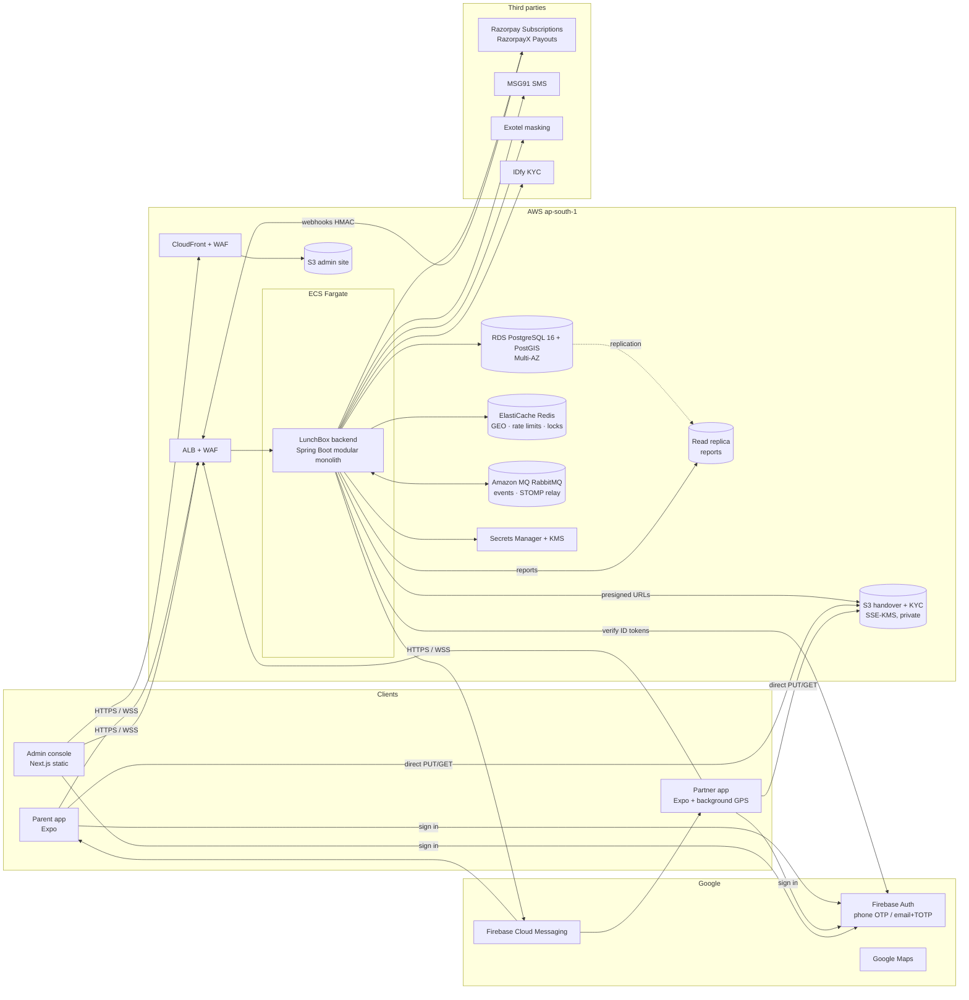
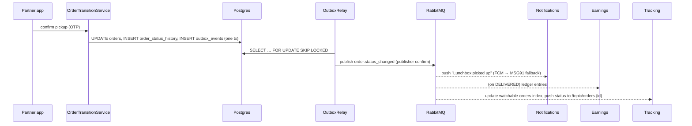
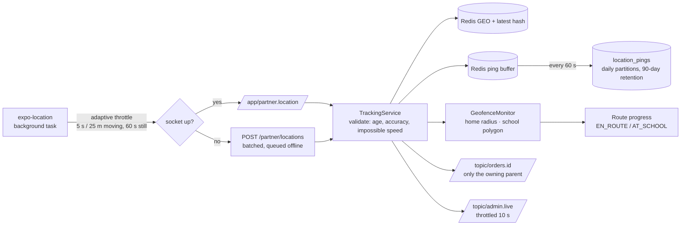

# Architecture

## System context

## Backend: modular monolith

Package-by-feature under `com.lunchbox`. Each module exposes a small **public API** (`*Directory`, `*Queries`,
`*Commands` interfaces and records) and keeps its entities and repositories package-private. Modules never read each
other's repositories; they call those interfaces or react to events.

| Module | Owns | Public API |
|---|---|---|
| `auth` | Firebase token verification, security config, STOMP CONNECT auth | `Authenticator`, `IdentityProvider` |
| `users` | users, parents, consents, account export/deletion | `UserDirectory`, `ActivationPolicy` |
| `schools`, `children`, `addresses`, `serviceareas` | master data | `SchoolDirectory`, `ChildDirectory`, `AddressDirectory`, `ServiceAreaDirectory` |
| `subscriptions` | plans, subscriptions, leave days, Razorpay subscription webhooks | `SubscriptionQueries`, `SubscriptionEvents` |
| `orders` | orders, status history, state machine, nightly generation | `OrderCommands`, `OrderQueries`, `OrderEvents` |
| `dispatch` | partners, KYC, shifts, assignment, routes, partner-app operations, masked calls | `PartnerDirectory`, `DispatchTracking` |
| `verification` | pickup OTP / signed QR, geofenced handover photos | `PickupVerifier`, `HandoverVerifier` |
| `tracking` | STOMP endpoint, Redis GEO, ping persistence, geofence monitor | — |
| `notifications` | notification centre, push/SMS, broadcasts | `NotificationService` |
| `payments` | payments, invoices, Razorpay webhook inbox | `PaymentGateway`, `PaymentRecorder`, `RazorpayWebhookHandler` |
| `payouts` | earnings ledger, payouts, RazorpayX | `PayoutAccountRegistrar` (implements dispatch's) |
| `reports` | read-replica analytics (ADR-0009) | — |
| `audit` | append-only audit trail | `AuditService` |
| `admin` | platform settings, retention jobs | `PlatformSettings` |
| `common` | errors, idempotency, outbox, rate limiting, locks, crypto, geo, storage | — |

### Communication inside the monolith

- **Synchronous calls** through module interfaces for queries and commands.
- **In-process Spring events** (same transaction) where a change must be atomic across modules: a school holiday
  cancels that day's orders; removing a child cancels the subscription; removing an address is vetoed while a
  subscription uses it.
- **Transactional outbox → RabbitMQ** for everything asynchronous: order status changes, partner arrival, route
  completion, shift end/no-show, SOS, broadcasts, payouts. Consumers de-duplicate with `processed_events`.

## Order lifecycle

See [`state-machine.md`](state-machine.md). `OrderTransitionService` is the only writer of `orders.status`.

## Live tracking pipeline

The parent map animates the marker between fixes (`AnimatedRegion`), so 5-second updates look continuous.

## Dispatch

1. **Generation** — after the daily cut-off (admin setting, default 21:00 IST) a job turns active subscriptions into
   tomorrow's orders, skipping non-working days, holidays and leave days. Idempotent on `(child_id, scheduled_date)`.
2. **Assignment** — greedy nearest-available: orders in pickup-window order go to the partner with spare capacity
   and a scheduled shift whose start point is closest (halved distance when already serving that school). A Redis
   lock per order plus a partial unique index on active assignments make double assignment impossible.
3. **Routing** — per partner, a pickup-and-delivery VRP with time windows and capacity solved by OR-Tools
   (`OrToolsRouteOptimizer`); a deterministic school-cluster heuristic is the fallback. Re-planning keeps completed
   stops and re-optimises the rest.
4. **No-shows** — a shift not started 15 minutes after its planned start releases its orders for reassignment.

## Security model

See [`security.md`](security.md). Every HTTP request and STOMP CONNECT carries a Firebase ID token verified by the
Admin SDK; roles live in the LunchBox database (mirrored to custom claims). Authorisation is enforced twice:
`@PreAuthorize` on role, and ownership checks in services (parents only see their own orders; partners only their
assigned stops, only on the delivery day).

## Non-functional design

| Target | How |
|---|---|
| API p95 < 300 ms | Virtual threads, indexed queries, short-TTL principal cache, Redis for hot tracking state, read replica for reports |
| Live tracking < 3 s | STOMP broker relay, Redis-only hot path, persistence batched off the request path |
| 10k tracked deliveries | Stateless API behind ALB; RabbitMQ fan-out; k6 scenario in `load/tracking.js` |
| 99.9 % availability | Multi-AZ RDS/Redis/MQ, ECS min 3 tasks with circuit-breaker rollbacks, health/readiness probes, graceful shutdown |
| Flaky 4G | Partner offline action queue with idempotency keys; pings buffered and batch-sent |
| Observability | ECS-format JSON logs with `requestId`; OpenTelemetry traces; Prometheus metrics; CloudWatch alarms; Sentry |
