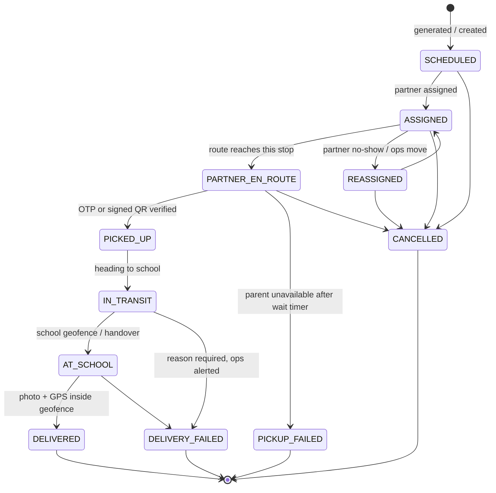

# Order state machine

Enforced by `com.lunchbox.orders.OrderStateMachine` (explicit transition table) and applied only by
`OrderTransitionService`, which in one transaction updates the order, appends `order_status_history` and writes an
`order.status_changed` outbox event.

| Rule | Where |
|---|---|
| A reason is mandatory for `CANCELLED`, `REASSIGNED`, `PICKUP_FAILED`, `DELIVERY_FAILED` | `OrderStateMachine.assertTransition` |
| Pickup can fail only after the partner arrived and waited `dispatch.pickup_wait_minutes` | `PartnerOperationsService.pickupFailed` |
| Holidays, leave days and ended subscriptions cancel only pre-pickup orders | `OrderLifecycleListeners` |
| Concurrent transitions (partner action vs geofence) serialise on a row lock | `OrderRepository.findForUpdate` |
| Account deletion is refused while a lunchbox is `PICKED_UP`/`IN_TRANSIT`/`AT_SCHOOL` | `OrderQueryService.erase` |

**Open question (recorded in PROGRESS.md):** the brief allows `REASSIGNED` only from `ASSIGNED`. A partner who has an
accident while `PARTNER_EN_ROUTE` therefore cannot be swapped without cancelling; ops can cancel and create a manual
order. Confirm whether `PARTNER_EN_ROUTE → REASSIGNED` should be added.
